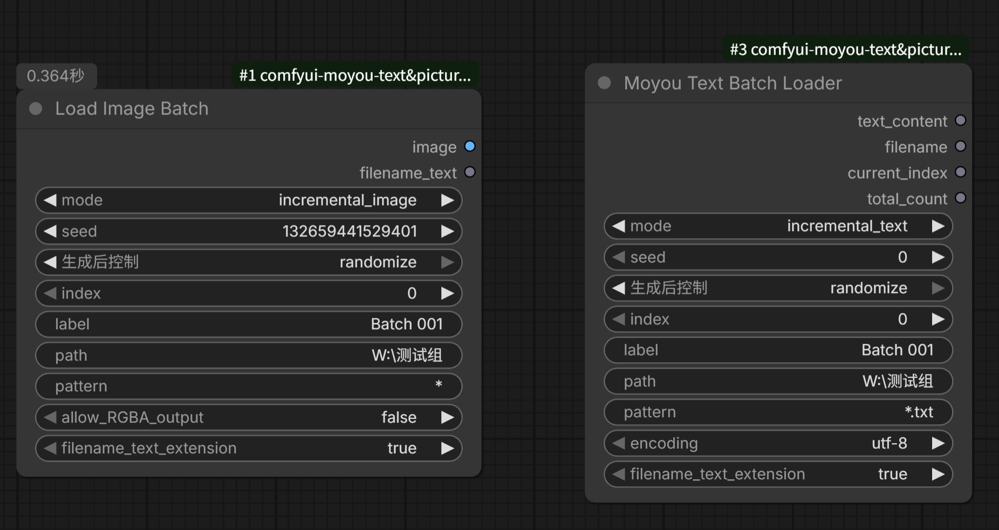

# comfyui-moyou-text&picture-batch-loader

ComfyUI 批次加载节点包：**每次批量运行时自动加载目录下的下一个文本 / 图像文件**（也可按编号指定或随机加载）。

适合大批量"一套提示词 + 一张参考图 → 生成一张图"的自动轮换出图场景，可在批量过程中实时观察每一批的测试结果。



## 节点列表

| 节点名 | 中文名 | 说明 |
| --- | --- | --- |
| Moyou Text Batch Loader | 加载批次文本 | 按批次加载目录下的 txt 文件内容 |
| Load Image Batch | 加载批次图像 | 按批次加载目录下的图像文件，移植自 [WAS Node Suite](https://github.com/WASasquatch/was-node-suite-comfyui) 的 Load Image Batch，**无需安装 WAS 即可使用** |

两个节点均无额外依赖（仅使用 ComfyUI 自带的 torch / numpy / Pillow）。

## 安装

1. 将 `comfyui-moyou-text&picture-batch-loader` 文件夹复制到 `ComfyUI/custom_nodes` 目录
2. 重启 ComfyUI
3. 在节点搜索框中输入 `moyou` 或 `Load Image Batch`（加载批次图像）即可添加节点

## 节点说明

### Moyou Text Batch Loader（加载批次文本）

**输入参数**

| 参数 | 默认值 | 说明 |
| --- | --- | --- |
| mode | single_text | `single_text`：按 index 加载指定文件；`incremental_text`：每次运行自动加载下一个文件（到末尾后回到第一个）；`random`：按 seed 随机加载 |
| seed | 0 | random 模式的随机种子（可配合"生成后控制 → randomize"每次换一个） |
| index | 0 | single_text 模式的文件编号，从 0 开始 |
| label | Batch 001 | 批次标签。不同 label 各自独立计数；修改 label、路径或模式后进度重置 |
| path | （空） | 文本文件所在目录的绝对路径 |
| pattern | \*.txt | 文件名通配符，如 `*.txt`、`prompt*.txt` |
| encoding | utf-8 | 文本编码，可选 `utf-8` / `gbk` / `utf-16` |
| filename_text_extension | true | filename 输出是否包含扩展名 |

**输出**

| 输出 | 类型 | 说明 |
| --- | --- | --- |
| text_content | STRING | 文本文件内容 |
| filename | STRING | 当前加载的文件名 |
| current_index | INT | 当前文件编号 |
| total_count | INT | 目录内匹配到的文件总数 |

文件按**文件名自然排序**（数字按数值比较，与资源管理器一致：1.txt → 2.txt → 10.txt）。

### Load Image Batch（加载批次图像）

**输入参数**

| 参数 | 默认值 | 说明 |
| --- | --- | --- |
| mode | single_image | `single_image`：按 index 加载指定图像；`incremental_image`：每次运行自动加载下一张（到末尾后回到第一张）；`random`：按 seed 随机加载 |
| seed | 0 | random 模式的随机种子 |
| index | 0 | single_image 模式的图像编号，从 0 开始 |
| label | Batch 001 | 批次标签。不同 label 各自独立计数；修改 label、路径或模式后进度重置 |
| path | （空） | 图像文件所在目录的绝对路径 |
| pattern | \* | 通配符，支持 `**` 递归匹配子目录；自动过滤非图像文件 |
| allow_RGBA_output | false | `true`：保留图像原始 RGBA 通道（透明图输出 4 通道）；`false`：统一转为 RGB |
| filename_text_extension | true | filename_text 输出是否包含扩展名 |

**输出**

| 输出 | 类型 | 说明 |
| --- | --- | --- |
| image | IMAGE | 加载的图像（自动应用 EXIF 旋转校正） |
| filename_text | STRING | 当前加载的文件名 |

支持扩展名：`.jpeg` `.jpg` `.png` `.tiff` `.gif` `.bmp` `.webp`，按**文件名自然排序**（与资源管理器一致）。

## 使用说明

### 典型工作流：批次提示词 + 批次参考图 → 批量出图

```
Moyou Text Batch Loader ──text_content──▶ CLIP Text Encode（正向提示词）
Load Image Batch ───────────image───────▶ VAE Encode / 图像输入等下游节点
```

1. 两个节点的 `path` 分别指向提示词目录和图像目录
2. `mode` 分别选择 `incremental_text` / `incremental_image`
3. 在 ComfyUI 的「队列数量（Queue）」中填入 N 并排队
4. 每执行一次，文本和图像各自动前进到下一个文件，循环轮换

### 关于 label（批次标签）

- 同一目录想跑多套独立进度时，使用不同 label
- 修改 `path` 或 `pattern` 后，该 label 的进度自动归零重新计数

### 关于进度保存

- **加载批次图像**：增量进度保存在插件目录的 `moyou_batch_state.json` 中，重启 ComfyUI 后继续上次进度（与 WAS 行为一致）
- **加载批次文本**：增量进度保存在内存中，重启 ComfyUI 或节点缓存失效后从头开始

## 注意事项

- `path` 必须为绝对路径；路径不存在或目录内没有匹配文件时，节点会在控制台报错并输出空值
- 文本文件解码失败时，`text_content` 会返回 `[解码错误]` 提示，可尝试切换 `encoding`
- 与 WAS Node Suite 可同时安装，节点互不冲突；本插件的图像节点不依赖 WAS 的数据库文件

## 演示


演示视频：
https://github.com/user-attachments/assets/de5f1467-3c67-4aa5-b5c7-7e0efe420bef

## 许可

MIT
